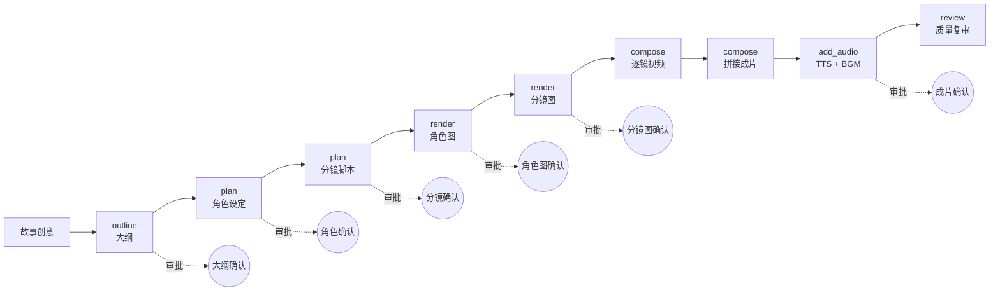

# PanelSmith · 格匠

<div align="center">
  <p><strong>故事想法 → 多智能体接力 → 漫剧成片</strong></p>
  <p>一个把「一格一格画出来」交给 AI 团队的漫剧工作台。</p>

  <p>
    
    
    
    
    
  </p>

  <p>
    <a href="#快速开始">快速开始</a> ·
    <a href="#它能做什么">功能</a> ·
    <a href="#生成链路">生成链路</a> ·
    <a href="#配置">配置</a> ·
    <a href="#常见坑">常见坑</a>
  </p>
</div>

---

PanelSmith 把一句故事创意串成 **大纲 → 角色 → 分镜 → 生图 → 视频 → 配音合成** 的完整链路：多个 AI Agent 按阶段接力，每一步都能停在审批点上等你改，改完从断点继续，而不是从头重跑。

> [!WARNING]
> 这是一个 **LangGraph 多阶段编排的学习 / 演示项目**，重点在于验证人机协作审批、可恢复执行、实时进度与前后端契约。
> **不建议直接用于生产环境**：进程内任务状态、单 worker 假设、鉴权均为「够跑通」级别。

## 它能做什么

- **无限画布审阅**：tldraw 把工作流的每个节点（故事、角色、分镜格、成片）投影成画布上的形状，选中任一实体，反馈就绑定在它身上。
- **九宫格分镜 + 单格重做**：分镜按漫画阅读顺序铺成多列网格，每格就是一个 *Cell*；可以单选/多选重做，不影响其它格。
- **六个审批闸口**：大纲、角色、分镜、角色图、分镜图、成片，每步都可查看、给意见、确认或取消。
- **Critic 质量闭环**：角色图与分镜图会打分，低于阈值自动重生成，最多重试 2 轮后强制放行。
- **可恢复执行**：LangGraph + Postgres checkpointer 保存断点；刷新页面、断线重连都能续上。
- **实时进度**：`/ws/projects/{id}` 推事件，重连时补发当前 run 状态，不错过任何一帧进度。
- **IP 宇宙**：把角色、风格模板抽成跨项目资产，续集自动继承同一套卡司。
- **免费配音**：Edge TTS 合成旁白 + 内置 BGM 混音，不需要任何额外 Key。
- **两种成品导出**：条漫长图（webtoon）与 PDF 分镜册，导出走异步任务，可查进度。
- **在线换模型**：配置面板可直接改文本/图像/视频 provider 与模型，不用改代码重启。

## 生成链路



五个 Agent 各管一段：`outline` 出故事骨架、`plan` 出人设与分镜、`render` 出图、`compose` 出视频与混音、`critic` 做质量审查。审批点用 LangGraph `interrupt()` 挂起，前端给反馈后以 `Command(resume=…)` 唤醒 —— 这是整个项目里最值得读的一段（`backend/app/orchestration/driver.py`）。

内置三个工作流（`backend/app/skills/catalog.py`）：

| Skill | 定位 | 起点 |
|---|---|---|
| `story-anime` 剧情故事 | 一句话开故事，默认 8 镜，走全链路 | 大纲 |
| `character-design` 角色设计 | 先把人设定死，再用少量镜头验收 | 角色 |
| `quick-short` 快短片 | 跳过细调，默认自动模式快速出片 | 分镜 |

## 技术栈

| 层 | 选型 |
|---|---|
| 前端 | React 18 + TypeScript + Vite + tldraw + TanStack Query + daisyUI |
| 后端 | FastAPI + SQLModel + LangGraph（Postgres checkpointer） |
| 数据 | PostgreSQL（业务表 + 图状态）+ Redis（confirm 信号） |
| 媒体 | Pillow（拼图/导出）+ reportlab（PDF）+ Edge TTS（配音）+ insightface（人脸一致性） |
| 观测 | 结构化日志 + 思考链 WebSocket 推送 |

## 快速开始

### 方式一：Docker（最快）

```bash
cp backend/.env.example backend/.env
# 编辑 backend/.env，至少填通一类模型服务（见下方「配置」）
docker-compose up -d
```

- 前端：http://localhost:15173
- API 文档：http://localhost:18765/docs
- 健康检查：http://localhost:18765/health

> `docker-compose.yml` 同时带 `build:`，所以首次 `up` 会在本地构建镜像，不依赖任何镜像仓库。想边改边跑（代码热挂载、端口让开本地服务）用 `docker-compose -f docker-compose.dev.yml up -d`。

### 方式二：本地开发

```bash
# 后端（Python 3.10+，uv）
cd backend
uv sync
uv run uvicorn app.main:app --reload --host 0.0.0.0 --port 18765

# 前端（Node 18+，pnpm）
cd frontend
pnpm install
pnpm dev
```

本地开发时前端会按页面 hostname 自动推导后端 `18765` 端口，通常不需要写 `frontend/.env.local`；后端不在默认地址时才配 `VITE_API_URL` / `VITE_WS_URL`。

### 零成本试跑（不调外部 API）

只想看链路跑通、不花钱：把三个 provider 都切成 `fake`。

```bash
TEXT_PROVIDER=fake
IMAGE_PROVIDER=fake
VIDEO_PROVIDER=fake
FAKE_TEXT_RESPONSE=这是 Fake 文本 Provider 的本地测试响应
FAKE_VIDEO_FIXTURE_URL=/static/videos/dev_clip.mp4
```

文本返回固定响应、图像返回内置占位 SVG、视频播放你放进去的样片，而编排、审批、进度、续跑逻辑全是真跑。

## 配置

所有配置集中在 `backend/.env`（模板见 `backend/.env.example`），也可在运行后用配置面板在线覆盖。

| 能力 | Provider | 默认 | 需要填什么 |
|---|---|---|---|
| 文本 | `anthropic` / `openai` / `fake` | `anthropic` | `ANTHROPIC_AUTH_TOKEN` + `ANTHROPIC_BASE_URL`（中转站，国内可用），或 `TEXT_API_KEY` |
| 图像 | `modelscope` / `openai` / `fake` | `modelscope` | `IMAGE_API_KEY`（默认模型 `Tongyi-MAI/Z-Image-Turbo`） |
| 视频 | `doubao` / `openai` / `fake` | `doubao` | `DOUBAO_API_KEY`（火山方舟），或 `VIDEO_API_KEY` |
| 配音 | Edge TTS（内置） | 开启 | 不需要 Key |

几个容易忽略的开关：

- `ENABLE_IMAGE_TO_IMAGE`：分镜首帧参考图。普通文生图模型会忽略参考图，只有 Edit 类模型才真吃到 `image_url`。
- `ENABLE_IMAGE_TO_VIDEO` / `VIDEO_IMAGE_MODE`：`first_frame` 只用分镜首帧，`reference` 把角色图与分镜图拼一起（人物一致性更好，成本更高）。
- `CRITIQUE_SCORE_THRESHOLD` / `CRITIQUE_MAX_ROUNDS`：Critic 打分阈值与重试轮数。
- `ADMIN_TOKEN`：配置面板写操作的 `X-Admin-Token`，公网部署必须设。
- `PUBLIC_BASE_URL`：把 `/static/...` 拼成外网可访问的完整 URL；图生视频时若没配，会尝试把本地图内联为 data URL。

## 项目结构

```
.
├── backend/
│   ├── app/
│   │   ├── agents/          # outline / plan / render / compose / critic + prompts
│   │   ├── orchestration/   # LangGraph 图、状态、driver（interrupt 循环）、持久化
│   │   ├── skills/          # 工作流预设（directives / 模板 / 管线提示）
│   │   ├── api/v1/routes/   # projects / generation / shots / characters / export / universes …
│   │   ├── services/        # 文本、图像、视频、TTS、合成、导出
│   │   ├── models/          # SQLModel 业务表
│   │   ├── ws/              # WebSocket 管理器
│   │   └── static/          # 生成产物（images / videos / exports / bgm）
│   ├── alembic/             # 迁移
│   └── tests/
├── frontend/
│   └── app/
│       ├── pages/           # Home / Projects / Project（导演台）/ Universes
│       ├── features/        # comic-workflow 画布、projects、skills
│       ├── components/      # canvas / chat / panels / settings
│       └── styles/          # tokens.css（设计契约的唯一真源）
├── docs/                    # 架构决策（ADR）、前端重设计程序、上游产品对照
├── PRODUCT.md               # 用户、定位、品牌与设计原则
├── DESIGN.md                # 视觉与交互规格
├── CONTEXT.md               # 领域术语表（Director Desk / Cell / Shot Grid …）
└── AGENTS.md                # 给 AI 协作者的工程须知（先读这个）
```

主要接口（前缀 `/api/v1`）：

| 接口 | 作用 |
|---|---|
| `POST /projects/{id}/generate` | 起一次生成 run |
| `POST /projects/{id}/resume` / `cancel` / `feedback` | 续跑 / 取消 / 带反馈重跑 |
| `GET /projects/{id}/generation-state` | 断点恢复用的控制面 |
| `POST /projects/{id}/export/webtoon` | 导出条漫长图 |
| `POST /projects/{id}/export/pdf` | 导出 PDF 分镜册 |
| `GET /projects/{id}/export/{export_id}/status` | 导出任务进度 |
| `WS /ws/projects/{id}` | 进度、审批请求、思考链 |

## 常用命令

```bash
# 后端
cd backend
uv run pytest                              # 全量
uv run pytest tests/test_api/test_generation.py -q
uv run ruff check app tests

# 前端
cd frontend
pnpm test                                  # vitest
pnpm build                                 # tsc + vite build
pnpm e2e                                   # playwright（只自动起前端）
```

## 交付前的验收路径

改完 UI 或编排，走一遍这条最短路径：

1. 首页选 `story-anime` → 填故事 → 进入导演台
2. 看大纲 / 角色 / 分镜三个审批点是否都能「看内容 → 提意见 → 确认」
3. 画布选中某一格 → 对话面板的反馈应只作用于这一格
4. 单格重做 → 其它格与已确认内容不能被清掉
5. 生成中刷新页面 → 进度与审批弹窗应自动补发，不出现空白等待
6. 成片出来 → 视频可播放，条漫长图与 PDF 分镜册都能导出成功

## 常见坑

| 症状 | 原因与解法 |
|---|---|
| Docker 里图像/视频接口连不上 | 服务在宿主机时 `IMAGE_BASE_URL` 不能用 `localhost`，改 `host.docker.internal` 或宿主 IP |
| 生成跑到一半卡住不动 | `task_manager` 是进程内字典，`WEB_CONCURRENCY` 必须为 `1`，多 worker 会丢信号 |
| 提交反馈后没反应 | confirm 走 Redis 信号，先确认 Redis 通、且前端 WS 已连上 |
| 数据库结构变了但启动没建表 | `init_db()` 会 `create_all()` 并初始化配置；生产路径请用 `alembic upgrade head` |
| Alembic 连错了库 | `backend/alembic.ini` 默认指向本地 SQLite，跑迁移前用 `DATABASE_URL` 覆盖 |
| 改了依赖但容器里没生效 | `backend/Dockerfile` 用 `uv sync --frozen`，要同步提交 `uv.lock` |
| 前端单测过了但页面白屏 | 跑 `pnpm build`，`tsc` 才查得全类型错误 |

## 文档索引

| 文件 | 内容 |
|---|---|
| `PRODUCT.md` | 目标用户、产品目的、品牌调性、设计原则 |
| `DESIGN.md` | 视觉与交互规格（漫画风、CMYK / halftone、密度） |
| `CONTEXT.md` | 领域术语表：Director Desk、Agent Column、Shot Grid、Cell、Selection Binding |
| `docs/adr/` | 三条关键决策：重设计范围、设计契约即代码、交互软冻结 |
| `docs/frontend-redesign-program.md` | 前端重设计的分批交付计划 |
| `docs/product-parity.md` | 能力清单、Phase 0–5b 演进状态与明确的非目标 |

## License

MIT
